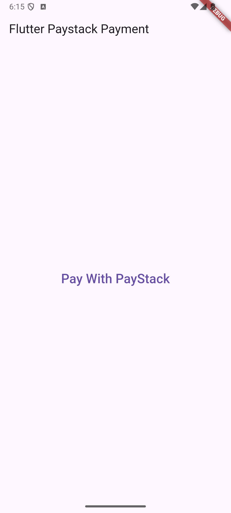
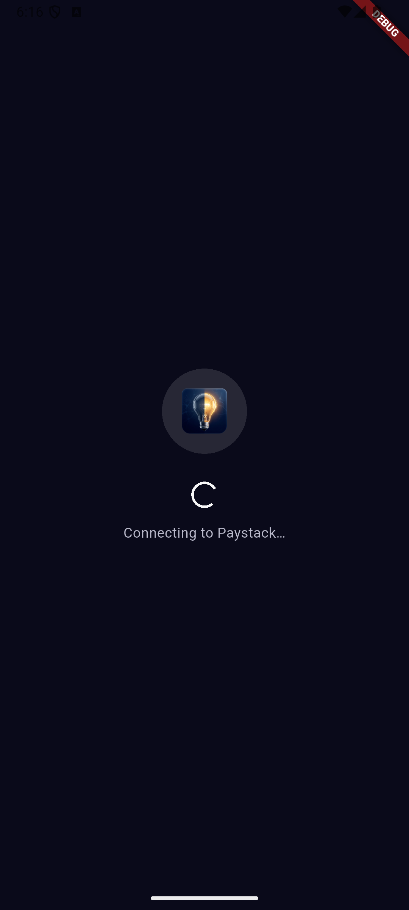
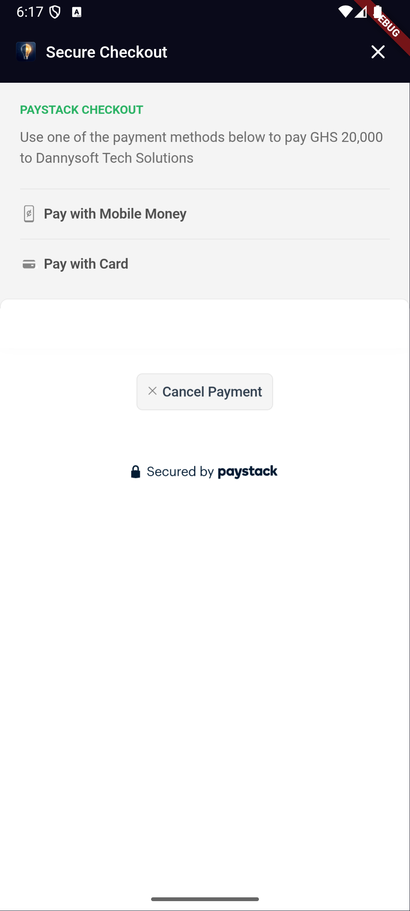
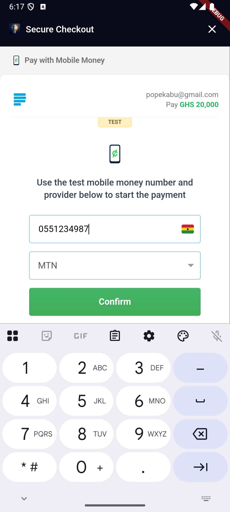
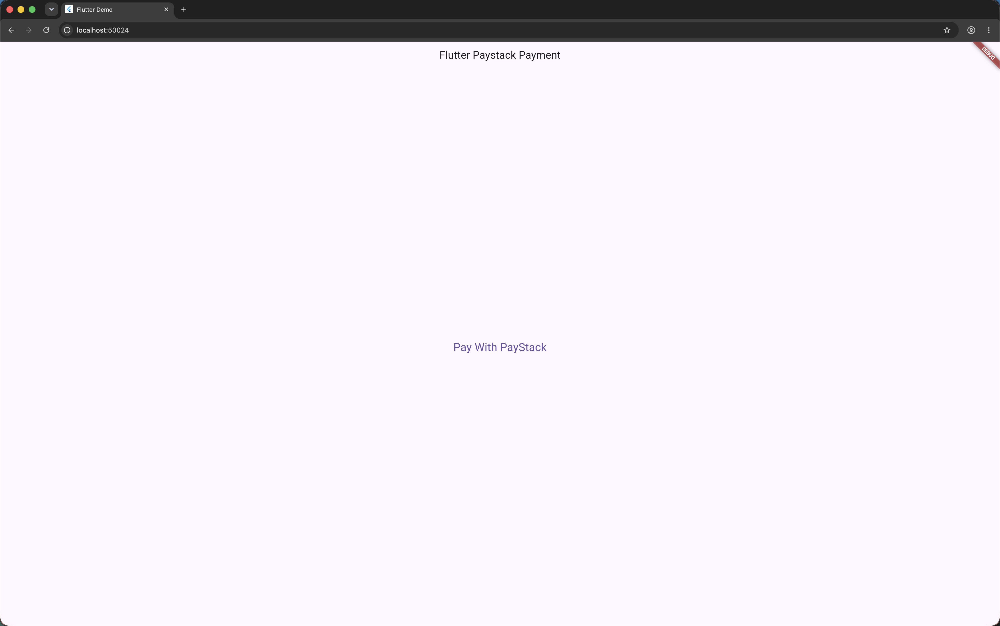
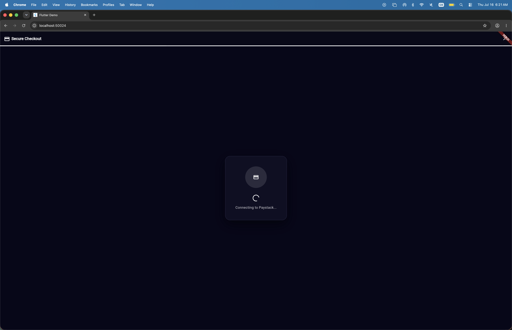
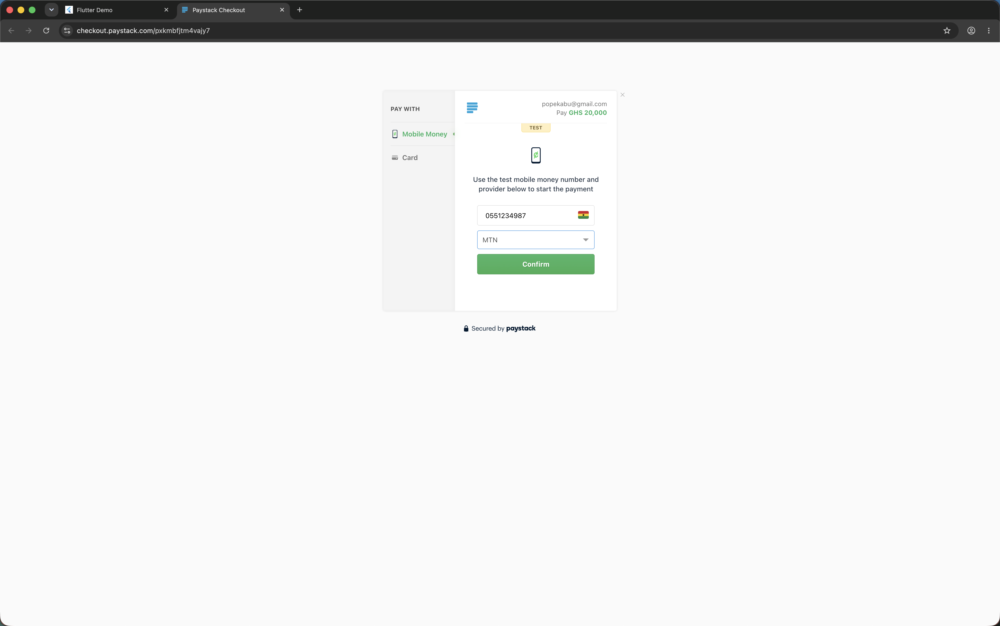
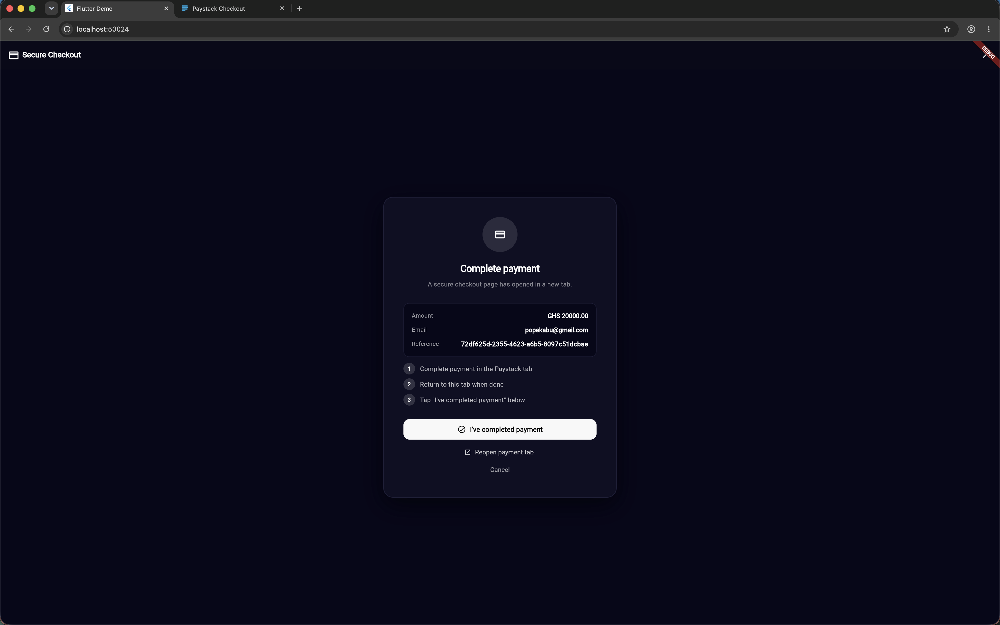

## Features

- Mobile Money
- VISA / Mastercard / Verve
- Bank
- Bank Transfer
- USSD
- QR
- EFT

### Platform Support

| Platform | Status | How it works |
|----------|--------|-------------|
| **Android** | ✅ | Paystack Inline Popup in a WebView |
| **iOS** | ✅ | Paystack Inline Popup in a WebView |
| **Web** | ✅ | Opens Paystack hosted checkout in a new browser tab |
| **macOS / Windows / Linux** | ✅ | Opens Paystack hosted checkout via `url_launcher` |

---

## ⚠️ Migrating from v1.x → v2.0.0

v2.0.0 is a **breaking change** that addresses [Issue #23](https://github.com/popekabu/pay_with_paystack/issues/23) — the package no longer requires or uses the Paystack **secret key** (`sk_…`) in client code.

### What you need to change

**1. Replace `secretKey` with `publicKey`:**

```diff
// In PaystackConfig:
- PaystackConfig(secretKey: 'sk_live_xxxx')
+ PaystackConfig(publicKey: 'pk_live_xxxx')

// In PayWithPayStack().now():
- PayWithPayStack().now(secretKey: 'sk_live_xxxx', ...)
+ PayWithPayStack().now(publicKey: 'pk_live_xxxx', ...)
```

**2. Add server-side verification:**

In v1.x the plugin verified payments client-side using your secret key. In v2.0.0, your **backend** must verify payments. When checkout completes, send `data.reference` to your server and call:

```
GET https://api.paystack.co/transaction/verify/:reference
Authorization: Bearer sk_live_xxxx   ← secret key stays on your server only
```

**3. Backend-only methods are now `@Deprecated`:**

`chargeAuthorization()`, `bulkCharge()`, and related methods now show a compile-time deprecation warning reminding you to move them to a secure server.

---

## Getting Started

### Android

Update `android/app/build.gradle`:

```groovy
android {
    compileSdkVersion 34  // use latest

    defaultConfig {
        minSdkVersion 19
    }
}
```

### iOS

No extra configuration required.

---

## Security

> **This package uses only the Paystack public key (`pk_…`) — the secret key (`sk_…`) is
> never required or used in client code.**
>
> Embedding a secret key in a mobile or web app is a serious security vulnerability.
> Secret keys can be extracted via decompilation or network inspection and grant full
> API access (refunds, transfers, subaccount management, etc.).
>
> **Transaction verification must be done server-side.** When checkout completes, your
> backend at `callbackUrl` receives the reference and should call
> `GET /transaction/verify/:ref` with the secret key to confirm the payment.

---

## Global Configuration (optional)

Call `PayWithPayStack.configure()` once at app startup to set shared defaults so you
don't have to repeat `publicKey`, `currency`, and `callbackUrl` on every call:

```dart
import 'package:flutter/foundation.dart';
import 'package:pay_with_paystack/pay_with_paystack.dart';

void main() {
  PayWithPayStack.configure(PaystackConfig(
    publicKey: 'pk_live_xxxxxxxxxxxxxxxxxxxx', // ← public key only (pk_…)
    currency: 'GHS',
    callbackUrl: 'https://my-app.com/payment/callback',
    enableLogging: kDebugMode, // logs in debug, silent in release
    timeout: const Duration(seconds: 30),
  ));
  runApp(const MyApp());
}
```

Once configured, the three fields can be omitted on individual calls:

```dart
await PayWithPayStack().now(
  context: context,
  customerEmail: 'user@example.com',
  reference: PayWithPayStack().generateUuidV4(),
  amount: 50.00,
  transactionCompleted: (data) => print('Paid!'),
  transactionNotCompleted: (reason) => print('Failed: $reason'),
);
```

| PaystackConfig field | Type       | Default | Description |
|----------------------|------------|---------|-------------|
| `publicKey`          | `String`   | —       | Your Paystack **public** key (`pk_…`) |
| `currency`           | `String?`  | `null`  | ISO 4217 currency code |
| `callbackUrl`        | `String?`  | `null`  | Backend URL Paystack redirects to after checkout |
| `enableLogging`      | `bool`     | `false` | Print request/response to console (debug only) |
| `timeout`            | `Duration` | `30s`   | Max wait time for Paystack API |

---

## Basic Usage

```dart
import 'package:pay_with_paystack/pay_with_paystack.dart';

final ref = PayWithPayStack().generateUuidV4();

await PayWithPayStack().now(
  context: context,
  publicKey: 'pk_live_XXXXXXXXXXXXXXXXXXXXX', // ← public key (pk_…), never secret key
  customerEmail: 'user@example.com',
  reference: ref,
  currency: 'GHS',
  amount: 50.00,          // GHS 50.00 — converted to pesewas automatically
  callbackUrl: 'https://your-backend.com/verify',
  transactionCompleted: (PaymentData data) {
    print('[OK] Payment callback received for: ${data.reference}');
    // Your backend at callbackUrl verifies this server-side using the secret key.
  },
  transactionNotCompleted: (String reason) {
    print('[FAIL] Payment not completed: $reason');
  },
  transactionCancelled: () {
    print('[CANCELLED] User closed checkout without paying');
  },
);
```

---

## Payment Channels (type-safe)

Use the `PaystackChannel` enum instead of raw strings:

```dart
channels: [
  PaystackChannel.card,
  PaystackChannel.mobileMoney,
  PaystackChannel.bankTransfer,
],
```

| Enum value                     | API string        |
|--------------------------------|-------------------|
| `PaystackChannel.card`         | `card`            |
| `PaystackChannel.bank`         | `bank`            |
| `PaystackChannel.ussd`         | `ussd`            |
| `PaystackChannel.qr`           | `qr`              |
| `PaystackChannel.mobileMoney`  | `mobile_money`    |
| `PaystackChannel.bankTransfer` | `bank_transfer`   |
| `PaystackChannel.eft`          | `eft`             |

---

## Currency (type-safe)

Use the `PaystackCurrency` enum to avoid typos in currency codes:

```dart
await PayWithPayStack().now(
  // ...
  currency: PaystackCurrency.ghs.value, // 'GHS'
);
```

| Enum value              | ISO code | Currency              |
|-------------------------|----------|-----------------------|
| `PaystackCurrency.ngn`  | `NGN`    | Nigerian Naira        |
| `PaystackCurrency.ghs`  | `GHS`    | Ghanaian Cedi         |
| `PaystackCurrency.zar`  | `ZAR`    | South African Rand    |
| `PaystackCurrency.usd`  | `USD`    | United States Dollar  |
| `PaystackCurrency.kes`  | `KES`    | Kenyan Shilling       |
| `PaystackCurrency.xof`  | `XOF`    | West African CFA Franc|
| `PaystackCurrency.egp`  | `EGP`    | Egyptian Pound        |
| `PaystackCurrency.rwf`  | `RWF`    | Rwandan Franc         |

---

## Customer Prefill

Pre-fill the customer's name and phone on the checkout form so they don't have
to type it themselves:

```dart
PayWithPayStack().now(
  // ...
  customerFirstName: 'Daniel',
  customerLastName: 'Asare',
  customerPhone: '+233244000000',
);
```

These are automatically added as `custom_fields` in the transaction metadata so
they also appear on your Paystack Dashboard.

---

## Cart Items

Attach a typed list of cart line items to the transaction. These appear in the
transaction metadata on your Paystack Dashboard:

```dart
PayWithPayStack().now(
  // ...
  cartItems: [
    PaystackCartItem(name: 'Wireless Headphones', amount: 15.00, quantity: 1),
    PaystackCartItem(name: 'Phone Case', amount: 2.50, quantity: 2),
    PaystackCartItem(name: 'Charging Cable', amount: 5.00),
  ],
);
```

> Amounts are in the **major** currency unit (e.g. GHS 15.00). The plugin
> converts to pesewas / kobo automatically.

---

## Custom Fields (Dashboard-visible)

Add custom fields that appear on the Paystack Dashboard when viewing the
transaction:

```dart
PayWithPayStack().now(
  // ...
  customFields: [
    PaystackCustomField(
      displayName: 'Order ID',
      variableName: 'order_id',
      value: '#ORD-1234',
    ),
    PaystackCustomField(
      displayName: 'Delivery Zone',
      variableName: 'delivery_zone',
      value: 'Accra Central',
    ),
  ],
);
```

---

## Split Payments

Route a portion of a payment to a subaccount or a pre-defined split group.

### Subaccount split

```dart
PayWithPayStack().now(
  // ...
  subaccount: 'ACCT_xxxxxxxxxx',   // your subaccount code
  bearer: PaystackBearer.account,  // main account bears fees (default)
);
```

### Flat fee override

```dart
PayWithPayStack().now(
  // ...
  subaccount: 'ACCT_xxxxxxxxxx',
  transactionCharge: 5.00,          // GHS 5.00 flat fee goes to main account
  bearer: PaystackBearer.subaccount, // subaccount bears Paystack fees
);
```

### Pre-defined split group

```dart
PayWithPayStack().now(
  // ...
  splitCode: 'SPL_xxxxxxxxxx',
);
```

| Parameter           | Type               | Description |
|---------------------|--------------------|-------------|
| `subaccount`        | `String?`          | Subaccount code (`ACCT_xxx`) to split payment |
| `splitCode`         | `String?`          | Pre-defined split group code (`SPL_xxx`) |
| `transactionCharge` | `double?`          | Flat fee (major unit) for main account |
| `bearer`            | `PaystackBearer?`  | Who bears Paystack fees |

---

## Subscriptions

```dart
PayWithPayStack().now(
  // ...
  plan: 'PLN_xxxxxxxxxx',
  invoiceLimit: 12,  // charge 12 times then stop
);
```

---

## Transaction Cancelled Callback

Distinct from `transactionNotCompleted`, the `transactionCancelled` callback fires
when the user explicitly **closes** the checkout WebView without attempting any
payment:

```dart
PayWithPayStack().now(
  // ...
  transactionCancelled: () {
    // e.g. log the abandonment or show a nudge
    print('User closed checkout without paying');
  },
);
```

---

## Network Options

Control timeouts and request logging per call (or set defaults via `PaystackConfig`):

```dart
PayWithPayStack().now(
  // ...
  timeout: const Duration(seconds: 15),  // override the 30s default
  enableLogging: true,                   // print request/response to console
  onTimeout: () {
    // called instead of transactionNotCompleted when the request times out
    ScaffoldMessenger.of(context).showSnackBar(
      const SnackBar(content: Text('Request timed out. Please try again.')),
    );
  },
);
```

| Parameter       | Type            | Default | Description |
|-----------------|-----------------|---------|-------------|
| `timeout`       | `Duration?`     | `30s`   | Max wait time for Paystack API |
| `enableLogging` | `bool?`         | `false` | Log requests/responses via `debugPrint` |
| `onTimeout`     | `VoidCallback?` | `null`  | Called on timeout; if `null`, `transactionNotCompleted('timeout')` is called |

---

## Customising the Checkout UI

Customize the look, colors, and display texts of your checkout (especially on Flutter Web where the full checkout waiting state is rendered within your app UI):

```dart
PayWithPayStack().now(
  context: context,
  // ...
  showAppBar: true,
  appBarTitle: 'Pay Now',
  appBarColor: const Color(0xFF0A0A1A),
  appBarTextColor: Colors.white,

  // Accent color for loading spinner, progress bar, and "Try Again" button
  progressColor: const Color(0xFF00C386),
  progressBackgroundColor: const Color(0xFF1E1E2E),

  // Web background and card containers customisation
  backgroundColor: const Color(0xFF07071A),
  cardBackgroundColor: const Color(0xFF0F0F24),
  cardBorderColor: const Color(0xFF1E1E38),
  primaryTextColor: Colors.white,
  secondaryTextColor: Colors.white70,
  buttonTextColor: Colors.black,

  // Web text overrides
  connectingText: 'Connecting to Paystack...',
  waitingTitleText: 'Complete your payment',
  waitingSubtitleText: 'A checkout page has opened in a new tab.',
  step1Text: 'Complete payment in the new tab',
  step2Text: 'Return here when done',
  step3Text: 'Tap the confirmation button below',
  completedButtonText: "I've completed payment",
  reopenButtonText: 'Reopen payment tab',
  cancelButtonText: 'Cancel payment',
  verifyingText: 'Confirming your payment...',
  verifyingSubtitleText: 'Please wait while we verify your transaction.',

  // Custom logo widget (replaces deprecated logoUrl to support CORS-safe image assets or icons)
  logoWidget: Image.asset('assets/images/logo.png'),

  // Custom loading screen (replaces default pulsing loader)
  loadingWidget: const Center(
    child: CircularProgressIndicator(color: Colors.green),
  ),

  // Custom error screen with retry
  errorWidget: (String error, VoidCallback retry) => Center(
    child: Column(
      mainAxisSize: MainAxisSize.min,
      children: [
        Text(error),
        ElevatedButton(onPressed: retry, child: const Text('Retry')),
      ],
    ),
  ),
);
```

---

## Raw Metadata

Attach any extra key-value data to the transaction:

```dart
metadata: {
  'cart_id': '12345',
  'custom_fields': [
    {
      'display_name': 'Promo Code',
      'variable_name': 'promo_code',
      'value': 'SAVE10',
    },
  ],
},
```

---

## Charging a Returning Customer (Silent Re-charge)

> ⚠️ **Backend use only.** `chargeAuthorization` calls Paystack's
> `POST /transaction/charge_authorization` endpoint which requires a **secret key**.
> This method is **deprecated** for direct client-app use. Move this call to a
> secure backend endpoint and invoke it from your server.

If you are calling this from a server-side Dart/Flutter backend:

```dart
// Only reusable authorizations can be recharged:
if (previousPaymentData.authorization?.reusable == true) {
  // ignore: deprecated_member_use
  await PayWithPayStack().chargeAuthorization(
    authorizationCode: previousPaymentData.authorization!.authorizationCode!,
    customerEmail: 'user@example.com',
    amount: 50.00,
    currency: 'GHS',
    secretKey: 'sk_live_xxxx', // ← only safe on a server, never in a client app
    reference: PayWithPayStack().generateUuidV4(),
    transactionCompleted: (data) => print('Recharged: ${data.reference}'),
    transactionNotCompleted: (reason) => print('Failed: $reason'),
  );
}
```

---

## Bulk Charges (Bulk Payment)

> ⚠️ **Backend use only.** All bulk charge methods require a **secret key** and are
> **deprecated** for direct client-app use. Move these calls to your secure backend.

---

## Error Handling (PaystackException)

`chargeAuthorization` throws a `PaystackException` when the API returns a
non-200 status code. It is also available for your own error-handling logic:

```dart
try {
  await PayWithPayStack().chargeAuthorization(/* ... */);
} on PaystackException catch (e) {
  print(e.message);      // human-readable error
  print(e.statusCode);   // HTTP status code
  print(e.responseBody); // raw Paystack response body
}
```

---

## Full Parameter Reference

| Parameter                  | Type                                     | Required | Default              |
|----------------------------|------------------------------------------|----------|----------------------|
| `context`                  | `BuildContext`                           | ✅       | —                    |
| `customerEmail`            | `String`                                 | ✅       | —                    |
| `reference`                | `String`                                 | ✅       | —                    |
| `amount`                   | `double`                                 | ✅       | —                    |
| `transactionCompleted`     | `Function(PaymentData)`                  | ✅       | —                    |
| `transactionNotCompleted`  | `Function(String)`                       | ✅       | —                    |
| `publicKey`                | `String?`                                | ❌*      | global config        |
| `currency`                 | `String?`                                | ❌*      | global config        |
| `callbackUrl`              | `String?`                                | ❌*      | global config        |
| `transactionCancelled`     | `VoidCallback?`                          | ❌       | `null`               |
| `channels`                 | `List<PaystackChannel>?`                 | ❌       | all channels         |
| `plan`                     | `String?`                                | ❌       | `null`               |
| `invoiceLimit`             | `int?`                                   | ❌       | `null`               |
| `subaccount`               | `String?`                                | ❌       | `null`               |
| `splitCode`                | `String?`                                | ❌       | `null`               |
| `transactionCharge`        | `double?`                                | ❌       | `null`               |
| `bearer`                   | `PaystackBearer?`                        | ❌       | `null`               |
| `customerFirstName`        | `String?`                                | ❌       | `null`               |
| `customerLastName`         | `String?`                                | ❌       | `null`               |
| `customerPhone`            | `String?`                                | ❌       | `null`               |
| `customFields`             | `List<PaystackCustomField>?`             | ❌       | `null`               |
| `cartItems`                | `List<PaystackCartItem>?`                | ❌       | `null`               |
| `metadata`                 | `Map<String, dynamic>?`                  | ❌       | `null`               |
| `timeout`                  | `Duration?`                              | ❌       | `30s` (or config)    |
| `enableLogging`            | `bool?`                                  | ❌       | `false` (or config)  |
| `onTimeout`                | `VoidCallback?`                          | ❌       | `null`               |
| `showAppBar`               | `bool`                                   | ❌       | `true`               |
| `appBarTitle`              | `String`                                 | ❌       | `"Secure Checkout"`  |
| `appBarColor`              | `Color?`                                 | ❌       | dark theme default   |
| `appBarTextColor`          | `Color?`                                 | ❌       | `Colors.white`       |
| `progressColor`            | `Color?`                                 | ❌       | Paystack green `#00C386` |
| `progressBackgroundColor`  | `Color?`                                 | ❌       | `Color(0xFF1E1E2E)`  |
| `loadingWidget`            | `Widget?`                                | ❌       | branded loader       |
| `errorWidget`              | `Widget Function(String, VoidCallback)?` | ❌       | branded error UI     |
| `logoWidget`               | `Widget?`                                | ❌       | `null`               |
| `backgroundColor`          | `Color?`                                 | ❌       | `Color(0xFF07071A)`  |
| `cardBackgroundColor`      | `Color?`                                 | ❌       | `Color(0xFF0F0F24)`  |
| `cardBorderColor`          | `Color?`                                 | ❌       | `Color(0xFF1E1E38)`  |
| `primaryTextColor`         | `Color?`                                 | ❌       | `Colors.white`       |
| `secondaryTextColor`       | `Color?`                                 | ❌       | `Colors.white70`     |
| `buttonTextColor`          | `Color?`                                 | ❌       | `Colors.black`       |
| `connectingText`           | `String?`                                | ❌       | `'Connecting to Paystack…'` |
| `waitingTitleText`         | `String?`                                | ❌       | `'Complete your payment'` |
| `waitingSubtitleText`      | `String?`                                | ❌       | `'A Paystack checkout page has opened in a new tab.'` |
| `step1Text`                | `String?`                                | ❌       | `'Complete payment in the Paystack tab'` |
| `step2Text`                | `String?`                                | ❌       | `'Return to this tab when done'` |
| `step3Text`                | `String?`                                | ❌       | `'Tap "I\'ve completed payment" below'` |
| `completedButtonText`      | `String?`                                | ❌       | `'I\'ve completed payment'` |
| `reopenButtonText`         | `String?`                                | ❌       | `'Reopen checkout tab'` |
| `cancelButtonText`         | `String?`                                | ❌       | `'Cancel payment'` |
| `verifyingText`            | `String?`                                | ❌       | `'Verifying transaction…'` |
| `verifyingSubtitleText`    | `String?`                                | ❌       | `'Please wait while we confirm your payment with Paystack.'` |

\* Required if no global config has been set via `PayWithPayStack.configure()`.

---

## PaymentData Reference

| Field                        | Type             | Description |
|------------------------------|------------------|-------------|
| `id`                         | `int?`           | Transaction ID |
| `status`                     | `String?`        | `"success"`, `"failed"`, etc. |
| `reference`                  | `String?`        | Transaction reference |
| `domain`                     | `String?`        | Paystack domain (`live` / `test`) |
| `amount`                     | `int?`           | Amount in smallest unit (kobo/pesewas) |
| `requestedAmount`            | `int?`           | Originally requested amount in smallest unit |
| `currency`                   | `String?`        | Currency code |
| `channel`                    | `String?`        | Payment channel used |
| `fees`                       | `int?`           | Fees in smallest unit |
| `feesSplit`                  | `dynamic`        | Fee split details (if applicable) |
| `paidAt`                     | `String?`        | Payment timestamp |
| `createdAt`                  | `String?`        | Transaction creation timestamp |
| `gatewayResponse`            | `String?`        | Gateway message |
| `message`                    | `String?`        | Paystack API message |
| `receiptNumber`              | `String?`        | Receipt number |
| `orderId`                    | `String?`        | Order ID |
| `ipAddress`                  | `String?`        | Customer IP address |
| `customer`                   | `Customer?`      | Customer details |
| `authorization`              | `Authorization?` | Card/auth details |
| `isSuccessful`               | `bool`           | `true` when `status == "success"` |
| `amountInMajorUnit`          | `double?`        | `amount / 100` |
| `requestedAmountInMajorUnit` | `double?`        | `requestedAmount / 100` |
| `feesInMajorUnit`            | `double?`        | `fees / 100` |

---

## Screenshots

### Mobile Checkout

   

### Web Checkout






---

## Additional Information

For bug reports and feature requests, open an issue on [GitHub](https://github.com/popekabu/pay_with_paystack/issues).

## Contributors

A big thank you to all contributors:

- @joelarmah
- @pat64j
- @keezysilencer
- @Princewil
- @richprince23
- @VhiktorBrown

Feel free to contribute — the project is open to the public!

## Contributing, Issues, and Bug Reports

Submit a detailed report <a href="https://github.com/popekabu/pay_with_paystack/issues">here</a>.

## Support My Work

Buy me a coffee: <a href="https://buymeacoffee.com/popekabu">here</a>. Thank you for your support!
